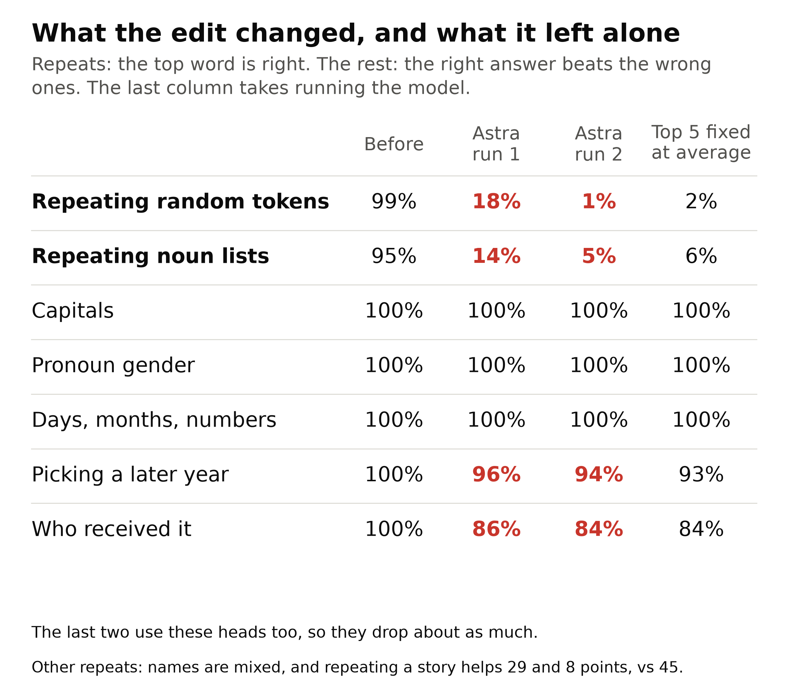

# What later experiments found

These follow the [reading result](README.md) and ask how it works, what else can be read, whether reading can become writing, and what changes at a bigger size. Most results had a prediction written before they ran, and a separate agent reran or recomputed them, which often narrowed the claim. Those predictions are in [locked cards](.research/cards/), and the [ledger](.research/ledger.jsonl) records each card's hash and result. The verifiers' scripts and outputs stay local. Several predictions failed, and those are marked. Astra's runs are in `runs/`, each one call log per turn. Totals are from one model and few runs, so treat them as leads rather than settled facts.

## Reading can become writing, on GPT-2 small
Asked to make the model stop repeating while keeping ordinary text, with Python, no forward pass and scrambled weights, Astra wrote edits to the weights and never saw a score. Both runs cut the source head's written directions out of the induction heads' keys. Run 2 edited all top 5 heads plus 5.0, and run 1 edited 4 of them plus 5.0, missing 7.2. Run 2 also changed all 6 heads' outputs, moving their VO by 16 to 34% (`checks/outputs/edit_touched_heads.txt`). The answers they named score 4 and 3 of 5 in `result.json`, because run 2 named the source head 4.11. [How the edit runs found them](HOW_ASTRA_FOUND_THEM.md#how-the-edit-runs-found-them) shows what they were given and the tables they chose from. `checks/audit_write_runs.py` finds no code in any write run that runs the model, and shows the two flags in `result.json` are print lines saying no forward pass was run.

| Edit | Repeat accuracy | Rise in text loss |
|---|---|---|
| Unedited | 0.987 | 0 |
| **Astra, run 1** | **0.180** | **0.013** |
| **Astra, run 2** | **0.011** | **0.013** |
| Simple edit, run 1's heads | 0.014 | 0.021 |
| Simple edit, run 2's heads | 0.002 | 0.022 |
| Simple edit, top 5 | 0.012 | 0.020 |
| Simple edit, next 5 | 0.985 | 0.000 |
| Simple edit, 16 random sets of 5, excluding the top ten | 0.972 to 0.987 | 0.019 to 0.268 |
| Simple edit, all 36 heads of layers 5 to 7 | 0.000 | 0.667 |
| Top 5 keys zeroed | 0.128 | 0.620 |
| Top 5 outputs zeroed | 0.295 | 1.066 |
| All of layers 5 to 7, outputs zeroed | 0.010 | 0.222 |
| Top 5 fixed at their average output, which needs a forward pass | 0.016 | 0.004 |

The simple edit reduces each head's keys to what its constant query reads from them, the same projection Astra's run 1 used to protect that term, so it isn't independent of Astra. It needs only the head list. The outputs call it the head list edit. Rows come from `checks/outputs/edit_demo.txt`, `checks/outputs/edit_controls.txt` and `checks/outputs/write_baselines.txt`. The rises are in units of cross-entropy, on 64 story windows of 48 tokens.

As shares of text loss, `checks/outputs/edit_text_loss.txt`:

| Story windows | Astra, run 1 | Astra, run 2 | Top 5 fixed at their average output |
|---|---|---|---|
| Scored, 64 of 48 tokens | 0.40% | 0.38% | 0.11% |
| Other draws of 64 of 48 tokens, 3 seeds | 0.46 to 0.76% | 0.42 to 0.69% | 0.13 to 0.36% |
| Another 400 of 48 tokens | 0.58% | 0.50% | 0.20% |
| 100 of 256 tokens | 1.98% | 1.93% | 1.97% |
| Those windows, past token 128 | 2.82% | 2.69% | 2.97% |

**The edit needs the list and the projection together.** On the top 5, zeroing keys costs 0.620 and the projection 0.020. The same edit does nothing to repeating on the next 5 or on random heads, including random heads in the right layers, so knowing the layers isn't enough for it. Those random sets exclude the top ten, and on short lists they range from 0.56 to 0.98, so lists are less specific than random tokens. Layers 5 to 7 can be hit without finding any head, by zeroing their outputs, at 0.222, about ten times the text cost of the short list. We measured what the list saves, not how hard it is to find, and a script with the known statistic also finds it. The top 5 is itself defined by attention on repeats, though Astra's own lists, chosen from weights alone, give 0.014 and 0.002.

**Other forms of edit.** Fixing the top 5 at their average output does as well on repeating at less text cost, but needs running the model, which Astra couldn't do. Zeroing is a poor baseline. Run 1's weaker score comes from its edit and not its list, because the simple edit on the same heads reaches 0.014.

### What else the edits changed
To test "keeps the rest", we scored five other capabilities and, separately, fixed the top 5 heads at their average output on stories, which needs a forward pass, to see what depends on them (`checks/edit_side_effects.py`, `checks/outputs/edit_side_effects.txt`, `checks/outputs/side_effect_breakdown.txt`). Zeroing is a different arm. In the picture the two repeat rows are top-token accuracy, the other five are the first table below, and "Top 5 fixed at average" is this fix.

Each cell here is the share of 200 prompts where the best right token beats the best of the listed wrong tokens. Prompts are drawn with repeats, so the distinct prompts are fewer than 200.

| On GPT-2 small, right token beats the listed wrong ones | Distinct prompts | Unedited | Astra, run 1 | Astra, run 2 | Top 5 fixed at their average output |
|---|---|---|---|---|---|
| Capitals | 16 | 1.000 | 1.000 | 1.000 | 1.000 |
| Pronoun gender | 96 | 1.000 | 1.000 | 1.000 | 1.000 |
| Days, months, numbers | 23 | 1.000 | 1.000 | 1.000 | 1.000 |
| Picking a later year, or later years: "The war lasted from the year 1732 to the year 17" | 88 | 1.000 | 0.955 | 0.945 | 0.930 |
| Who received it, or indirect object: "When Mary and John went to the store, John gave a drink to" | 199 | 0.995 | 0.865 | 0.835 | 0.835 |

The same prompts, asking instead that a right token be the model's top token:

| On GPT-2 small, right token on top | Unedited | Astra, run 1 | Astra, run 2 | Top 5 fixed at their average output |
|---|---|---|---|---|
| Capitals | 14% | 14% | 14% | 14% |
| Pronoun gender | 100% | 100% | 100% | 100% |
| Days, months, numbers | 100% | 91% | 91% | 91% |
| Picking a later year | 100% | 95.5% | 94.5% | 93% |
| Who received it | 92.5% | 73.5% | 69.5% | 68.5% |

Capitals' top token is right only 14% of the time, before and after, because the next token is usually " the". The fall in sequences is one prompt, "Here: Thursday, Friday,", drawn 18 times.

The edits leave capabilities that don't depend on these heads at 100% by the first measure, and cost the dependent ones about what fixing the heads costs. The sequence task still loses confidence, a margin of 2.73 falling to 2.07 and 1.99, against 2.34 with the heads fixed, so it isn't untouched. A simple edit on random sets of 5 drops capitals as low as 0.81, so these scores can move. These are five tasks we chose, with prompts that start near 100%, so they would miss smaller changes. On GPT-Neo the edits keep capitals and pronouns, but indirect object falls to 0.845 and 0.940 and facts fall as noted below.

**The match with the fix holds prompt by prompt.** Each prompt's drop in margin correlates 0.96 to 0.99 between the edits and the fix, on years and indirect object. The prompts they flip mostly coincide: the fix flips 32 indirect-object prompts, which include 24 of run 1's 26 and 31 of run 2's 32, and it flips 14 year prompts, which include all of run 1's 9 and run 2's 11.

**Controls, and a caveat.** Fixing the next 5 leaves years at 100% and indirect object at 96.5%. Four random sets of 5 leave years at 100% and indirect object at 92 to 100%. But random set 0 cuts indirect object's top token to 57.5%, below the top 5's 68.5%. And with averages from the task's own prompts instead of stories, the top 5 only take years to 97.5%, so part of that fall comes from using a story average.

**The size of the year fall depends on the prompts.** All are on GPT-2 small, from `checks/outputs/side_effect_breakdown.txt`:

| Other prompts, right token beats the listed wrong ones | Unedited | Astra, run 1 | Astra, run 2 | Top 5 fixed at their average output |
|---|---|---|---|---|
| Years, 8 nouns, 13th to 19th centuries, 300 prompts, 291 distinct | 97% | 77% | 74% | 76% |
| Of those, 13xx | 100% | 56% | 49% | 59% |
| Of those, start years 75 to 97 | 87% | 35% | 33% | 30% |
| Indirect object, 3 other templates, 300 prompts, 299 distinct | 100% | 96% | 94% | 94% |

**The earlier check on these prompts.** `checks/other_abilities.py` chooses heads on each ability's first 100 prompts and scores them on its last 100. The two halves overlap: of the 100 scored, capitals 100, sequences 95, years 65, pronouns 49 and indirect object 0 also appear among the 100 used to choose. So the falls in `checks/outputs/other_abilities.txt` aren't held-out numbers, and the size of the inflation isn't measured.

### What the edits do on plain English
The repeat score used random tokens and Astra ran nothing, so it never saw these lists. Prompts are fixed in `checks/edit_demo.py` before it runs, after earlier list checks, and every output is in `checks/outputs/edit_demo.txt`. A code review found our first name prompts started with the name, which is then a different token from the same name later on, so they didn't repeat at all. The rows below use the corrected prompts.

| On GPT-2 small | Unedited | Astra, run 1 | Astra, run 2 | Simple edit, run 2's heads | Top 5 outputs zeroed |
|---|---|---|---|---|---|
| Short lists of common nouns "a, b, c, a, b," right word | 0.95 | 0.14 | 0.05 | 0.05 | 0.40 |
| Five-word lists repeated, right word | 0.94 | 0.33 | 0.08 | 0.08 | 0.45 |
| Name again in a new sentence, right name | 0.25 | 0.44 | 0.25 | 0.23 | 0.17 |
| Name again in a second sentence, right name | 0.26 | 0.48 | 0.23 | 0.29 | 0.66 |
| Who lives where, right city | 0.15 | 0.13 | 0.36 | 0.44 | 0.01 |
| 30 plain facts, right on top | 15 | the same 15 | the same 15 | 14 | 10 |
| Top next token unchanged on stories | 1 | 0.95 | 0.95 | 0.96 | 0.52 |

**Examples depend on wording, so the video's example is picked by a rule.** "Words: dog cat tree house car dog cat tree" gave "dog dog dog" after the edit, but with "Context:", "Prompt:", "List:" or no first word, the edited models mostly still said "house", though the heads' attention moved away. So `checks/video_example.py` measures templates over 300 random lists and takes the first list that's right before and wrong after in both runs: "Context: door chair car door chair" goes from "car door chair" to "chair chair chair" in both. On that template the right word falls from 0.92 to 0.27 and 0.17.

**The edits weaken lists and random-token repeats. Repeated names are mixed.** On the repo's rare names, the right surname's top-token share rises in run 1 and stays at 0.25 and 0.23 in run 2, though run 2's log probability of it falls about 1 nat (-3.05 to -4.08, -2.78 to -3.72). With 100 pairs of common names, it goes from 0.44 and 0.31 to 0.13 and 0.17 in run 2, while run 1 is mixed at 0.29 and 0.49 (`checks/outputs/edit_names.txt`). So how much these heads carry names depends on the names and the measure.

**On short lists of common words, the edited models usually repeat a word they just saw and rarely the next one.** Over 600 such lists they pick a listed word 91 to 100% of the time, the right one 4 to 14%, and mostly the last word again (`checks/outputs/edit_order.txt`). We wrote this check after seeing the examples. When the first word isn't at position 0, it comes back more often: "Words: apple, chair, river, apple, chair," gives "apple" in run 2, and the first word again rises to 37 and 44% (`checks/outputs/edit_controls.txt`). It doesn't hold everywhere (`checks/outputs/edit_limits.txt`):

| | Unedited | Astra, run 1 | Astra, run 2 | Simple edit, run 2's heads |
|---|---|---|---|---|
| 3-word lists, 4 other word pools, right word | 0.62 to 0.89 | 0.00 to 0.31 | 0.00 to 0.08 | 0.00 to 0.05 |
| Same lists, any listed word | 0.83 to 1.00 | 0.50 to 0.94 | 0.31 to 0.86 | 0.36 to 0.88 |
| Random tokens, top token anywhere in the first copy | 0.99 | 0.25 | 0.04 | 0.02 |
| Text loss rise, 256-token windows | 0 | 2.0% | 1.9% | 2.5% |

**Copying on real stories falls by less on run 1.** Over the same targets, a window repeated gets 0.91, and the same window after the text that really came before it gets 0.46, which is ordinary prediction. So the gain from repeating falls from 45 points to 29 in run 1 and 8 in run 2 (`checks/outputs/edit_controls.txt`). "The old man walked to the market and bought three fish. The old man walked to the market and bought" still continues "three fish." Run 2 also edited the heads' outputs, which alone do almost nothing (repeat 0.986, from the verifier for [this locked card](.research/cards/astra_write2.md), whose script stays local).

**Where the five heads look after the edit.** On random-token repeats they put 0.90 of their attention on the matching position, and after run 2's edit 0.01, while position 0 goes from 0.04 to 0.87. That is mostly their default: over the first copy, before anything repeats, they already put 0.92 there. So the edit leaves them at their default rather than sending them somewhere new. In run 1 four heads fall to 0.02 or below, and 7.2, which it didn't edit, stays at 0.58.

## Another model: is it remembering GPT-2?
GPT-Neo 125M has GPT-2 small's layout but was trained separately, and its top induction heads sit in layers 6 and 8. We know of no published head list for it, which we couldn't check. The same edit task, scrambled, with its formula and size in the prompt (`prompts/write_neo.txt`, `scripts/run_write_neo.py`).

**What Astra could read.** The prompt never names the model, but Codex shows the model its working directory. Every live run's path included the project name `wsp-scaling` and the run's folder name, so `write-neo-1`, `write-neo-2`, `neo-blind` and `write-medium` had "neo" or "medium" in text Astra could read. GPT-2's edit runs, `write-write-1` and `write-write-2`, didn't name a model. Astra's visible replies never mention them and its reasoning is encrypted, so we can't tell whether it mattered. The call folder is now anonymous (`wsp/astra.py`), and clean reruns are set out in [a locked card](.research/cards/neo_clean_folder.md).

**The clean-folder reruns ([locked card](.research/cards/neo_clean_folder.md)).** We reran the no-weights call and both edit runs with the same prompts and seeds, moving only the call folder to a meaningless path. The prompt's size could still identify Neo. The first two runs stay published, and both sets are reported below.

| | Heads edited | Repeat accuracy | Text rise, scored 64 windows of 48 tokens | Text rise, 256 held-out windows of 48 tokens | Text rise, 64 held-out windows of 256 tokens | Facts right, of 30 (10 unedited) |
|---|---|---|---|---|---|---|
| Clean run 1 | Outputs of the same five heads as the first two runs | 0.010 | 0.088 | 0.100 | 0.214 | 7 |
| Clean run 2 | Keys of 6.6, 6.11, 6.0, 6.1 and 11.6 | 0.418 | 0.135 | 0.134 | 0.315 | 10 |

So three of four runs took the same route, and one went for the induction heads: 5 of Neo's top 10, 3 of its top 5, none in layer 8. Reader 6.1's attention falls from 0.957 to 0.013 in that run, yet repeats only fall to 0.418, and we haven't measured what carries the rest. Sources: `checks/outputs/neo_edit_check_clean_folder.txt`, `checks/outputs/neo_text_windows.txt`.

The no-weights call guessed 5.0, 5.4, 6.8, 7.3 and 7.10 (`runs/neo-blind__live__20261105T002622Z`), which hits 0 of the top 5. Those are layers 5, 5, 6, 7, 7, the same as GPT-2's blind call. With "neo" visible it had guessed layers 4, 5, 5, 6, 6. That's one call each.

Graded against the card: prediction 1 held, prediction 2 failed in run 2, prediction 3 held, with run 2 close to the bar at 0.418. The card says that a failure means the post and this section must say so, and that neither outcome settles memory of the method. Two of two runs took the previous-token route with "neo" visible and one of two without it, which is too few to tell whether the folder name mattered.

| | Repeat accuracy | Text rise, scored 64 windows of 48 tokens | Text rise, 256 held-out windows of 48 tokens | Text rise, 64 held-out windows of 256 tokens |
|---|---|---|---|---|
| Unedited | 0.960 | 0 | 0 | 0 |
| **Astra, run 1** | **0.003** | 0.147 | 0.158 | 0.279 |
| **Astra, run 2** | **0.005** | 0.078 | 0.091 | 0.208 |
| Same 5 heads, fixed at their mean, which needs a forward pass | 0.004 | 0.157 | not rerun | not rerun |
| Same 5 heads, zeroed | 0.005 | 0.207 | not rerun | not rerun |

The held-out columns are from `checks/outputs/neo_text_windows.txt`. This table used to give 0.165 and 0.097 for 256 held-out windows. Those came from a verifier's own draw of windows, and seed 777 in the same check gives them again, so the draw alone moves the rise by about 0.007. Long-context cost looks about 4 to 5 times GPT-2's: 0.279 and 0.208 here on 64 windows of 256 tokens, against 0.054 and 0.052 on 100 windows of 256 tokens (`checks/outputs/edit_limits.txt`), though the window sets differ.

**Our predictions mostly failed.** We predicted it would edit the induction heads at a text rise of 0.05 or less. Instead both runs edited the same five heads' outputs, 4.9, 5.0, 5.6, 5.8 and 7.1, which are Neo's top 5 previous-token heads (`checks/outputs/neo_edit_check.txt`), and named 0 of the top 5 induction heads. **[Our locked card](.research/cards/neo_edit.md) says that this failure means the GPT-2 result leaned on memory, so we report that reading here.** We don't think the data settle it either way. For memory: GPT-2 got its readers and Neo got its writers, Astra named GPT-2's top-5 layers, 5, 5, 6, 7, 7, with no weights (`runs/reading-blind__live__20261103T022900Z`), and run 2 labels the five writers "candidate induction heads". Against it: run 2's edit code has a list named `readers` holding all five top induction heads and 9 of the top 10, the edits drop reader 6.1's attention from 0.957 to 0.008 and 0.028 (printed by `checks/neo_edit_check.py`), and both runs used the same statistic as on GPT-2. That the edit cuts the same path from the other end is our reading, not something Astra stated. Run 1 has no reader list.

**What this rules out and what it doesn't.** Remembered head numbers can't have chosen these heads, since the scramble hides them. Remembered layers aren't ruled out: the five sit in layers 4 to 7, GPT-2's band, and one call shown no Neo weights, with "neo" visible in its folder path, guessed layers 4, 5, 5, 6, 6 (`runs/neo-blind__live__20261104T195053Z`). It doesn't rule out remembering the method, which run 2's printed "candidate induction heads" suggests it knows by name. Summing each head's match with later heads also finds these five, a formula written after seeing them, while a plain vote finds 2.

Neo also keeps less. Of the 10 of 30 facts it got right, run 1 and run 2 each keep 6, and run 2 newly gets "Merry", for 7 in all. Zeroing or mean-fixing the same heads keeps 3 and newly gets "The capital of Japan is", for 4 in all (`checks/outputs/neo_edit_check_named_folder.txt`). **The list does much of the work again.** Mean-fixing the same heads ties run 1 and costs more than run 2. Zeroing removes each head's constants, so it isn't a fair bar. Zeroing random sets of 5 is erratic here: repeat accuracy 0.5 or less in 5 of 16 sets, with those sets' text rises from 0.56 to 14.4, so Neo breaks easily and those sets aren't a clean control. Each run cost more than its $6 cap, $6.74 and $7.11.

On plain English (`checks/outputs/neo_edit_check.txt`), "apple, chair, river, apple, chair," goes from "river" to "chair, chair, chair" in both runs. Five-word lists fall from 0.91 to 0.09 and 0.15, and short comma lists from 0.83 to 0.07 and 0.27. Repeated names were already rare on Neo (0.03 and 0.06). One call and two runs are few.

## Swapping one ability for another
Asked to swap one capability for a specific other on scrambled GPT-2 small, with Python, no forward pass and no score: in the second copy of repeated random tokens, the top next token should be the current token instead of the next one, and everything else should stay (`prompts/swap.txt`, `scripts/run_swap.py`, [locked card](.research/cards/swap.md)). Both runs named the exact true top 5, and both failed the card's lowest bar.

| | Swap score | Old behaviour | Text rise | Facts of 30 | Capitals | Sequences | Indirect object |
|---|---|---|---|---|---|---|---|
| Unedited | 0.000 | 0.987 | 0 | 15 | 1.000 | 1.000 | 0.995 |
| **Astra, run 1** | **0.042** | 0.101 | 1.654 | 2 | 0.735 | 0.470 | 0.395 |
| **Astra, run 2** | **0.004** | 0.465 | 0.244 | 12 | 1.000 | 1.000 | 0.555 |
| Card's "partial swap" bar | at least 0.2 | | at most 0.10 | at least 10 | | | |

Scores are in each run's `swap_score.json` (`runs/swap-1__live__20261104T230230Z`, `runs/swap-2__live__20261104T232454Z`), and the audit finds no code in either that runs the model. Prediction 1, no run reaches "swap", held. Prediction 2, at least one "partial swap", failed. Prediction 3, old behaviour below 0.5 in both, held. **Finding the heads worked. Rewiring them with no forward pass didn't.** The edits broke repeating without putting the new behaviour in its place, and they damaged other abilities, most of all in run 1.

The card's locked baselines, which rewire the top heads to search like duplicate heads, are the bar for what a rewire can do: the best reaches swap 0.629, but with first-copy echo 0.667 and text rise 0.131. They used a list with head 0.3, which ranks 143 of 144, where the fifth-ranked duplicate head, 0.10, belongs. `checks/swap_feasibility.py` now has the right list, and `checks/outputs/swap_baselines.txt` and the others keep the old list's numbers, which we didn't remeasure.

## A bigger model: reading held up better than writing
On scrambled GPT-2 medium, 355M weights and Astra's single run, whose folder name held "medium" ([see above](#another-model-is-it-remembering-gpt-2)):
- **Reading:** the three sources it chose are that model's three strongest previous-token heads, 5.11, 4.13 and 6.7 (0.99, 0.96, 0.95, `checks/outputs/writer_statistic.txt`). It worked with several sources without being told there were several. Only 2 of its 5 targets are top-5 induction heads by attention.
- **Writing:** repeat accuracy 0.737 at text rise 0.135, which is not beyond deletion. Zeroing all of layers 5 to 7 gets 0.776 at 0.074. The simple edit does better on the same heads, 0.680 at 0.023, and also beats the same edit on the top 5 by attention, 0.901 at -0.033 (`checks/outputs/medium_head_list.txt`). These float32 scores move by up to 0.6 points with the thread count, so the check fixes it. It hit its $4.80 cap, but spent $6.43, about what small's run 2 spent, so budget doesn't obviously explain it. One run says little about size.

The known statistic also changes at this size. By best pairing, top-5 hits on attention score are 5, 2, 4 and 5 on GPT-2 small, medium, distilgpt2 and pythia-14m (`checks/outputs/other_models.txt`). Summing over strong writers gives 3, 4, 5, 5, a recipe written after seeing medium fail. No recipe wins everywhere.

Attention score alone misleads on medium. Zeroing the top 5 by attention costs 3.9 points of repeat accuracy, while best-pairing's 5 cost 41 to 43, against under 1 for same-layer heads. That doesn't mean the statistic sees what attention misses, since the earliest five high-attention heads cost about the same. Each head alone costs under 1 point, so the effect is joint, and zeroing them also raises text loss by 0.73 to 0.82 (`checks/outputs/write_baselines_medium.txt`). Removing their direct output costs 0.3 points, so the damage runs through later heads. How is unresolved (`checks/outputs/zero_order.txt`, `checks/outputs/medium_routes.txt`).

## How the mechanism holds up, on GPT-2 small
- **The earlier head is a previous-token head:** 4.11 is 98% on the previous token, the most of any head.
- **Several heads feed the keys together:** silencing the top 8 previous-token heads only for the five's keys takes their attention from 0.87 to 0.52, against 0.80 for random sets, and 4.11 alone gives 0.80. Through queries they don't move it (0.82, random 0.83). This holds with zero values (`checks/outputs/how_statistic_classifies.txt`), and with mean and resampled values in a verifier's check whose script stays local and which has no card.
- **Later heads depend on the five through their queries:** 10.7 and 11.10 fall from about 0.5 to under 0.2 under all three ablations, with random sets flat, and both push the attended token down (`checks/outputs/signed_ladder.txt`).
- **Attention to position 0 is a base rate:** 58 heads in layers 4 to 9 exceed 0.5 there. The five leaving it when a match appears is mostly softmax competition (`checks/outputs/first_position.txt`).

## What else can be read
Simple statistics on GPT-2 small, and with the token table where stated. These were chosen after trying many, with other models as the check.

| Kind of head | From the blocks alone | With the token table |
|---|---|---|
| Induction | 5 of 5 | no better |
| Duplicate | 4 of 5 | same hits with the table's rows shuffled, though that shuffle keeps each token's pairing, so it can't show the table is unused |
| Previous token | Top head ranks first on all 4 models. Most of the top 5 only on medium and distilgpt2 | not needed |
| Name mover | None | 4 of 5, through block 0's MLP |
| Negative heads like 10.7 and 11.10 | Not by value-output sign | First and second on GPT-2 small, and strongest ones first on medium and distilgpt2, Spearman about 0.8 on repeats, 0.43 to 0.54 on stories |
| S-inhibition | None | 1 of 5 at best |

This bears on [Ravfogel's question](https://x.com/ravfogel/status/2117642301442752692) of whether Astra reads only the first and last layers. Induction and previous-token heads read from middle blocks alone. For name movers and negative heads, the token table is what makes them readable to these statistics.

Asked openly to sort the heads, with no kind named (one run on GPT-2 small, `checks/outputs/astra_kinds.txt` and `runs/kind-open__live__20261104T043256Z`), Astra put the top 5 induction heads in one group, named real 4.11 as their source, and named layer 2's five highest previous-attention heads as a family. It also misplaced heads: 4.11 went into a 41-head group, and 10.7 and 11.10 weren't placed. Its "match and subtract" label doesn't hold up. Asked for duplicate heads, it got 4 of 5, the same as one line of code. Layer 2's family didn't generalize as a detector ([locked card](.research/cards/astra_open.md), result C006 in the [ledger](.research/ledger.jsonl)).

## What didn't work
- **Repeated names:** an earlier result here, that zeroing the five raises the right name, is withdrawn. Its prompts didn't repeat the name as a token. With corrected prompts, zeroing raises one template from 0.26 to 0.66 and lowers another from 0.25 to 0.17 (`checks/outputs/edit_demo.txt`). `checks/induction_examples.py`, `checks/signed_ladder.py` and `checks/why_names_rise.py` still use the old prompts.
- **Late heads don't carry medium's damage:** silencing medium's picks for later heads' queries cuts late attention 38% (`checks/outputs/medium_routes.txt`), but costs only 10 of the 41 points.

## Not checked
Astra's encrypted reasoning, so we can't tell whether it recognized GPT-2 or remembered the method. More than one or two runs per task. Other seeds for the medium runs. A model Astra couldn't have seen: Neo is public and could have been seen, though we know of no published head list for it. Whether the folder names mattered to the Neo and medium runs. Verifiers' scripts and outputs stay local, so results credited to a verifier can't be rerun from this repo.
