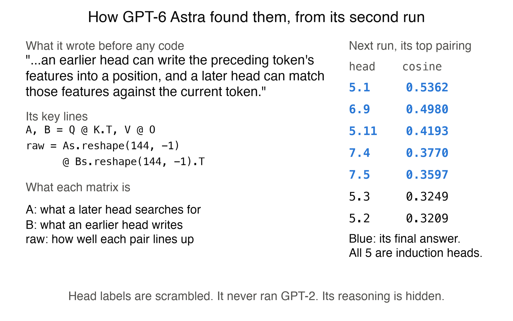

# How Astra found the induction heads

With Python and no method given, GPT-6 Astra named the five heads that score highest as induction heads on repeated random tokens, in both runs. GPT-2 has other, weaker ones, so this is the top of the list, not all of them. This is what the logs show about how, and what they can't show. Its reasoning is encrypted, so we have its replies, code, outputs and token counts, not its chain of thought.

## What it did, step by step
1. **It proposed the comparison before running any code.** Run 2, turn 1, in the words of the published circuit: "an earlier head can write the preceding token's features into a position, and a later head can match those features against the current token." Run 1 named only the comparison. Before that first code, run 1 used 1,291 reasoning tokens and run 2 used 972.
2. **It scored every earlier and later pair of heads, 9,504 in all.** For each head, `A = Q @ K.T` is roughly what it searches for and `B = V @ O` is roughly what it writes. These summarize weights, and are not measured activations. The cosine between a later head's A and an earlier head's B says how well they line up. It noted that these products don't depend on a head's internal coordinates, which is why the scrambling doesn't stop it.
3. **One earlier head stood out.** It is 4.9 in both runs' scrambled labels, by coincidence, and both are GPT-2's head 4.11. The seven best cosines in each run all pair with it.
4. **The top five pairings were the right heads.** Both runs' first ranking by cosine already has them first. This holds by cosine: in run 2's ranking by the raw dot product, other heads come first.
5. **It spent the remaining turns checking, and kept its picks.** It tried other weightings of the same comparison. These ranked shortlists of 10 to 14 heads, not all 144. Some let another head into the top five, 12 of 26 in run 1 and 2 of 8 in run 2, and it didn't change its answer, which is exactly its first cosine ranking in both runs.

Total reasoning was 6,542 tokens in run 1 and 5,759 in run 2. The no-tools runs logged 41,756 and 50,547, which may undercount, and failed.

## Did it cheat?
We looked for it and found none. A separate Claude agent, given the logs and not our conclusions, read every code block and session file. Run `PYTHONPATH=. python3 checks/audit_python_runs.py` to rerun what can be rerun. Our output is in [`checks/outputs/audit_python_runs.txt`](checks/outputs/audit_python_runs.txt).

| Check | Result | Can you rerun it? |
|---|---|---|
| Tools beyond Python | None. We ran 7 code blocks for it across 9 calls. The logged events are only replies, and the session files hold only messages and reasoning, on all 9 calls | Events yes, session files no |
| Hidden context | Billed input is the visible text plus exactly 20 tokens on all 9 calls. Visible text includes 4,079 tokens of Codex's own instructions, which is why billing exceeds the prompt. Codex memory was off and empty | Counts are saved, the files are not public |
| What its code touches | Only numpy, torch and threadpoolctl, with no files, network or other programs | Yes |
| Replay | Every code block prints exactly its logged output on the same weights | Yes, with the pinned packages. Last digits may differ on other machines |
| Prompt | Matches its frozen hash, with no answer, seed or model name. It defines the target, allows any linear algebra on the weights, and its syntax example uses `L5`, a layer holding two of these five heads. Astra's first code searches every layer, and a script with no layer rule gets the same five, so the method doesn't need `L5`, though we can't rule out that it nudged Astra. The working folder's path shows the project's name | Yes |
| Carry-over | 9 unique sessions, each extending only its own transcript | Yes, except hidden reruns, which rest on the session list |
| Forward passes | None. It does multiply in the layer norm's scale and remove a mean, with no input, and in some turns adds `shift @ raw` to a bias. The same statistic on raw weights picks the same five. The logged flag on run 2 is a variable called `forward_fraction` | The keyword scan and raw rerun yes. That no code runs a layer needs reading the 7 blocks, which are public |
| Score | Matching each head to real GPT-2 by its products, without our scramble record, gives 5 of 5 in both runs | Yes |

Codex's session files stay private because they contain its own instructions, so those rows rest on our saved counts.

## What this does not show
- **It can't separate memory from reasoning.** It stated a published circuit before running code, on a model whose shapes strongly suggest GPT-2. The scramble stops it submitting remembered head numbers, and recognizing the model or its patterns stays possible, though neither run names GPT-2. Its reasoning is encrypted, so we can't see whether it recognized GPT-2.
- **A script gets 5 of 5 too.** `checks/composition_statistic.py`, written after these runs, gets all five on five scrambles, though those share the same products, so they only vary the labels. Astra's contribution is choosing that statistic. Our baseline set before the runs, a simpler trace with a layer rule, got 3 of 5.
- **The two runs are closer to one measurement.** The scramble leaves `Q @ K.T` and `V @ O` unchanged, so both analyze the same underlying numbers, with different preprocessing and checks. They differ in the code Astra wrote, not the evidence.
- **Its code tests only the matching half of the circuit.** With no embeddings or positions, its code can't test "previous token" or copying. We tested those separately below, which it was not allowed to do.
- **It says little about size.** The deciding statistic uses about 28M of the 85M weights it could read, though the runs read more for their checks, about 61M and 35M, in one famous circuit on one model.
- **The two arms differ in more than Python.** The no-tools runs saw 20,000 values and the Python runs could read everything in the blocks.

## Why the statistic works
The code is plain linear algebra, and sorting its table takes no judgment. Astra's part was choosing what to compute.

An earlier head reads a token z and writes `z V O`. A later head compares its current token x against that position with `x (Q K^T) (V O)^T z^T`. If x equals z, a high score means "attend to the spot right after the earlier copy of this token", which is induction. Cosine of the flattened `Q K^T` and `V O` is that self-match, averaged over random directions.

We tested this on real GPT-2 with `checks/how_statistic_classifies.py` (output in [`checks/outputs/how_statistic_classifies.txt`](checks/outputs/how_statistic_classifies.txt)):

- **The earlier head does what the circuit says.** Head 4.11 puts 98% of its attention on the previous token, the most of all 144 heads.
- **The statistic sorts the top of the list well, not the whole list.** The five take ranks 1 to 5. Head 5.0 (copying 0.47) is 6th, but 5.8 (copying 0.07) is 7th, and 10.7, among the next five by copying score, ranks 41st. Spearman with copying score over later heads is 0.69.
- **The match is token-specific once embeddings are added.** Using the embeddings Astra never had, tokens score themselves highest through 4.11 and these five far above chance. See `checks/outputs/how_statistic_classifies.txt` for the numbers. An earlier version of this page said 2%, which came from a bug, now fixed.
- **4.11 is not needed alone, because several heads share its job.** Zeroing it barely changes repeating, 98.4% to 98.3%, and the five heads' attention falls from 0.87 to 0.81. Zeroing the top 8 previous-token heads in layers 1 to 4 takes that attention to 0.51 and repeating to 83.7%. Eight random sets of 8 other heads there average 0.80, with a lowest of 0.71, and repeating averages 93.3%. Cosine with other previous-token heads partly finds the same five: 4 of 5 with 2.2, 3 of 5 with 3.7.
- **A similar statistic finds another kind of head.** A head's own `trace(Q K^T)`, with no earlier head, shares 4 of 5 with the top duplicate-token heads, which attend to the earlier copy itself. It shares 0 of 5 with previous-token heads, which need the position table Astra doesn't have.

- **The signal reaches these heads mostly through their keys, the route the statistic points to.** With the top 8 previous-token heads silenced only for what the five heads' keys see, their attention falls from 0.87 to 0.52, and repeating to 89.7%. Eight random sets of 8 other heads average 0.80 and 95.7%. Through queries, those same 8 heads give 0.82 and random sets 0.83, so queries show no specific effect, though 5.1 does fall to 0.71. Nothing downstream is frozen, so 6.9 and the layer 7 heads also inherit changes from layer 5. Run 2 had hinted at this from weights alone: for head 5.1 it printed a key path of 114.2 against a reverse path of 38.2.

These use 25 random tokens repeated, where the README's silencing numbers use 50. They are zero ablations with few control sets, the 8 heads were chosen on the same kind of input, and they test the route, not the cosine itself, so they support the circuit without proving it.

## What these heads do
Zeroing the five heads together cuts correct repeating of random tokens from 98.6% to 28.9%, and of word lists from 93% to 47%. Zeroing the next five barely matters. Short lists like "apple, chair, river, apple, chair," fall from 93% to 43% over 300 lists, though single lists vary a lot, from 65% to 3% for this one to 24% rising to 80% for another. On a name repeated in an ordinary sentence, zeroing them makes the right name the top answer **more** often, for example 18% to 41% of cases, and using mean values instead changes some of these. We don't know why, and these five shouldn't be read as the whole story of in-context learning (`checks/induction_examples.py`).

To read it yourself: [run 1](runs/reading-python-1__live__20261104T014623Z/transcript.jsonl) and [run 2](runs/reading-python-2__live__20261104T015236Z/transcript.jsonl), one JSON line per turn.
