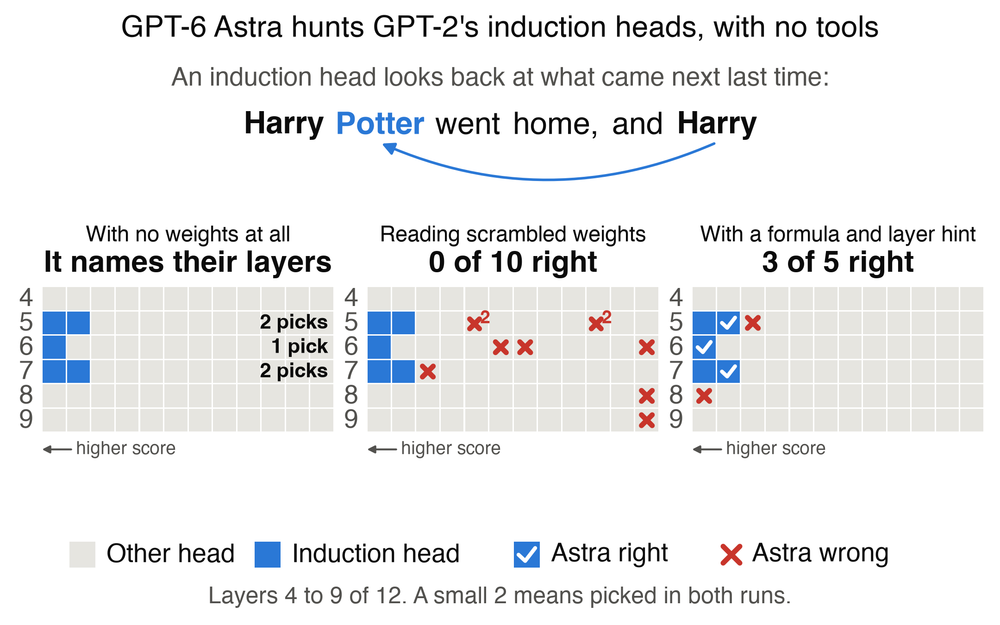

# Can GPT-6 Astra read and write GPT-2's weights?

By [Alex Bodner](https://twitter.com/AlexBodner_). A small follow-up to [Sparks of Weight-Space Programming](https://rikiyat.github.io/blog/weight-space-programming/), which reports that LLMs natively read and write network weights. They found every induction head in a 7M-weight model from its weights, using Python. We ask `gpt-6-astra` the same kind of question about a real LLM, GPT-2 small (124M weights), with no tools and without running the model. One model and few runs, and no size sweep has run.

## Reading
Given a formula and layer hint, it worked out 96 sums of 64 products on the raw weights with no tool calls in our logs, and found 3 of 5 induction heads, like a short script. Alone, it did no better than guessing.



GPT-2 small has 144 attention heads, the parts that choose which earlier tokens to focus on. Induction heads follow repeats: on seeing "Harry" again, they look at the token after the last "Harry", such as "Potter". [Anthropic described them in 2021](https://transformer-circuits.pub/2021/framework/) by inspecting and running models. Astra names 5 heads from a scrambled copy's weights, and we get the truth by running GPT-2 on repeated random tokens. The top five score 0.83 to 0.92, the next five 0.46 to 0.51, and those five are the [induction heads usually cited](https://dhruvpatel1706.github.io/writing/induction-heads.html) for GPT-2 small.

- **Alone, two reads:** 0 of 10. Our [frozen test](METHOD.md) counted the top 10, needed 6 of 10 and failed. Guessing also gets 0 of 10 about 32 to 48% of the time on that test, and 58 to 70% on the five induction heads, so the zero is weak evidence by itself. To check: [read 1](runs/reading-read-1__live__20261103T023015Z/audit.txt) and [read 2](runs/reading-read-2__live__20261103T144636Z/audit.txt).
- **No weights at all, one call:** it called its answer guesses, yet named layers 5, 5, 6, 7, 7, exactly where these five heads sit. That is likely recall: the prompt gives GPT-2's exact shape and weight count. Scrambling keeps layers and hides which head is which, and knowing the layers gets under 1 of 5.
- **With a hint, one read:** 3 of 5 induction heads, scored after the fact, against a mean of 2.6 for a script with the same formula, layer rule and budget. On the frozen top 10 test, that is 4 of 5 against 3.4. The hint gives a formula, the sum of `Q[r] . K[r]` over rows, which measures how well a head's query weights match its key weights, says this tends to be larger for these heads, and says to skip layers 0 to 3. We chose all of it after looking at GPT-2. On all rows without the layer rule, the formula finds 0 of 5, and on 20,000 values it reaches about 9%, so we cannot tell which part mattered. The read and hinted prompts also use `L5`, a layer holding these heads, in a syntax example, which we noticed only after the runs.
- **Its arithmetic:** it wrote out 96 sums of 64 products in its replies, and 86 match code to two decimals. No tool calls appear in our logs, but its reasoning is encrypted, so we cannot say how it got them.

To check the hinted read yourself:
- [The prompt](prompts/reading_hinted.txt), with the hint on line 42.
- [Astra's replies](runs/reading-hinted__live__20261103T144245Z/transcript.jsonl), one JSON line per turn, with its tables on lines 2 and 3 and its answer on line 6.
- [The score](runs/reading-hinted__live__20261103T144245Z/audit.txt), lines 9 to 15.

## Writing
Into an empty GPT-2, one call each, it wrote small circuits rather than language models:
- **Reverse a string:** 100% up to 6 letters, 0% from 7.
- **Name a capital:** 98.0% on the two phrasings it was shown, and 98.9% and 8.4% on two hidden ones.

Deleting layers does not change the capitals score. Our language run was stopped before any reply, so it has no result.

## What is here
- [METHOD.md](METHOD.md): the design, every result and its limits.
- [CONTEXT.md](CONTEXT.md): the post, the objection to it, and what its logs show.
- [DECISIONS.md](DECISIONS.md): a working log of how the design changed, not needed to check any result.
- `checks/`: the scripts behind the reading, writing, architecture and tokenizer numbers, with saved reading and some writing results in `checks/outputs/`.
- `wsp/`, `scripts/`, `tests/`: the pipeline. `prompts/` holds the frozen prompts.
- `runs/`: every Astra run. The script's 30 seeds keep only `summary.json`.

## Check it without downloading anything
This recounts the main numbers from saved files, with no GPT-2 and no model calls:

```bash
python3 checks/from_saved_logs.py
```

## Running it
Needs Python 3.10 or newer. GPT-2 downloads itself on first use, about 550 MB. Only the language task, Predict and the control need `data/`: [TinyStories](https://huggingface.co/datasets/roneneldan/TinyStories) `TinyStoriesV2-GPT4-valid.txt` as `data/tinystories/valid.txt` and the first 100 MB of `TinyStoriesV2-GPT4-train.txt` as `data/tinystories/train_first100mb.txt`, and the post's [Breakout files](https://github.com/RikiyaT/lm_understand-logs) in `data/control/`, with MinAtar 1.0.15 in `.deps/`.

```bash
pip install -r requirements.txt
```

```bash
PYTHONPATH=. python3 -m pytest tests
```

Score Astra's capitals reply, which gives 98.0% on the visible phrasings and 53.6% across the two hidden ones:

```bash
PYTHONPATH=. python3 scripts/run_experiment.py capitals --reply-file runs/capitals__live__20261103T002438Z/reply.md --label check
```

Audit a read, check its arithmetic, redraw the figures and rescore on the five induction heads, which needs the script's runs first:

```bash
PYTHONPATH=. python3 checks/read_audit.py runs/reading-hinted__live__20261103T144245Z
```

```bash
PYTHONPATH=. python3 checks/hinted_arithmetic.py runs/reading-hinted__live__20261103T144245Z
```

```bash
PYTHONPATH=. python3 scripts/reading_figure.py
```

```bash
PYTHONPATH=. python3 scripts/reading_solver.py
```

```bash
PYTHONPATH=. python3 checks/top_five.py
```

New Astra calls use `--live`, codex-cli 0.153.4 and a private helper, vlm-jigsaw, that seals each call and is not published. Saved runs and all scoring work without it, and each call's `seal` records what its scan found.

Three things are left out of this public copy of the logs: the control call's prompt, which holds GPL-licensed MinAtar source (its hash is in `prompts/MANIFEST.json`), the post's published Breakout answer, and Codex's model catalog (its hash is in each call). Codex's session files stay on the machine that ran them.
