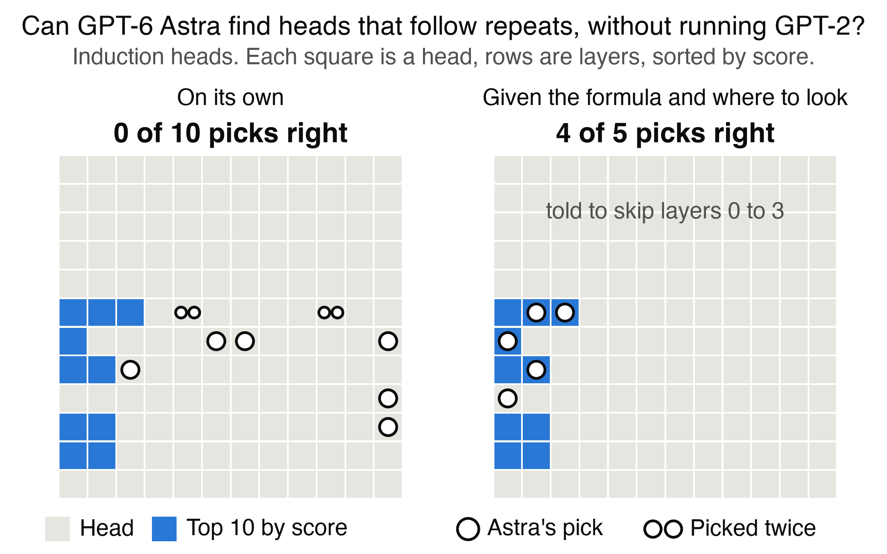

# Can GPT-6 Astra read and write GPT-2's weights?

A small test of [Sparks of Weight-Space Programming](https://rikiyat.github.io/blog/weight-space-programming/), which reports that LLMs natively read and write network weights, using `gpt-6-astra` on a real LLM, GPT-2 small (124M weights), with no tools and without running the model. Few runs, one model: no size sweep has run, despite this repo's name.

## Reading
Alone, it did no better than guessing. Given a formula and where to look, it got 4 of 5, close to a short script.



GPT-2 small has 144 attention heads, the parts that choose which earlier tokens to focus on. Induction heads follow repeats: on seeing "Harry" again, they look at the token after the last "Harry", such as "Potter". [Anthropic described them in 2021](https://transformer-circuits.pub/2021/framework/) by inspecting and running models. Astra names 5 heads from a scrambled copy's weights, and a pick counts if it is in the true top 10 when GPT-2 runs on repeated random tokens.

- **Alone, two reads:** 0 of 10. That failed our [pass rule](METHOD.md) of 6 of 10, set beforehand. Guessing also gets 0 of 10 about 32 to 48% of the time, so this is weak evidence by itself.
- **With a hint, one read:** 4 of 5. The hint gives a formula, its meaning and layers to skip, which we chose after looking at GPT-2. Without the layer rule the formula finds 0 of 5, so we cannot tell which part mattered. A script with the same formula, layer rule and budget averages 3.4 of 5.
- **Typed arithmetic:** 86 of its 96 typed results match code to two decimals. No tool calls appear in our logs, but its reasoning is encrypted, so we cannot say how it got them.

To check the hinted read yourself:
- [The prompt](prompts/reading_hinted.txt), with the hint on line 42.
- [Astra's replies](runs/reading-hinted__live__20261103T144245Z/transcript.jsonl), one JSON line per turn, with its tables on lines 2 and 3 and its answer on line 6.
- [The score](runs/reading-hinted__live__20261103T144245Z/audit.txt), lines 9 to 15.

## Writing
Into an empty GPT-2, one call each, it wrote small circuits rather than language models:
- **Reverse a string:** 100% up to 6 letters, 0% from 7.
- **Name a capital:** 98.0% on the two phrasings it was shown, and 98.9% and 8.4% on two hidden ones.

Deleting layers does not change the capitals score. Our language run was stopped before any reply, so it has no result.

## What is here
- [METHOD.md](METHOD.md): the design, every result and its limits.
- [CONTEXT.md](CONTEXT.md): the post, the objection to it, and what its logs show.
- [DECISIONS.md](DECISIONS.md): a working log of how the design changed, not needed to check any result.
- `checks/`: the scripts behind the reading, writing, architecture and tokenizer numbers, with saved results in `checks/outputs/`.
- `wsp/`, `scripts/`, `tests/`: the pipeline. `prompts/` holds the frozen prompts.
- `runs/`: every Astra run. The script's 30 seeds keep only `summary.json`.

## Running it
Needs Python 3.10 or newer. GPT-2 downloads itself on first use, about 550 MB. Only the language task, Predict and the control need `data/`: [TinyStories](https://huggingface.co/datasets/roneneldan/TinyStories) `TinyStoriesV2-GPT4-valid.txt` as `data/tinystories/valid.txt` and the first 100 MB of `TinyStoriesV2-GPT4-train.txt` as `data/tinystories/train_first100mb.txt`, and the post's [Breakout files](https://github.com/RikiyaT/lm_understand-logs) in `data/control/`, with MinAtar 1.0.15 in `.deps/`.

```bash
pip install -r requirements.txt
```

```bash
PYTHONPATH=. python3 -m pytest tests
```

Score Astra's capitals reply, which gives 98.0% and 53.6% across the two hidden phrasings:

```bash
PYTHONPATH=. python3 scripts/run_experiment.py capitals --reply-file runs/capitals__live__20261103T002438Z/reply.md --label check
```

Audit a read, check its arithmetic and redraw the figures:

```bash
PYTHONPATH=. python3 checks/read_audit.py runs/reading-hinted__live__20261103T144245Z
```

```bash
PYTHONPATH=. python3 checks/hinted_arithmetic.py runs/reading-hinted__live__20261103T144245Z
```

```bash
PYTHONPATH=. python3 scripts/reading_figure.py
```

New Astra calls use `--live`, codex-cli 0.153.4 and a private helper, vlm-jigsaw, that seals each call and is not published. Saved runs and all scoring work without it, and each call's `seal` records what its scan found.

Three things are left out of this public copy of the logs: the control call's prompt, which holds GPL-licensed MinAtar source (its hash is in `prompts/MANIFEST.json`), the post's published Breakout answer, and Codex's model catalog (its hash is in each call). Codex's session files stay on the machine that ran them.
