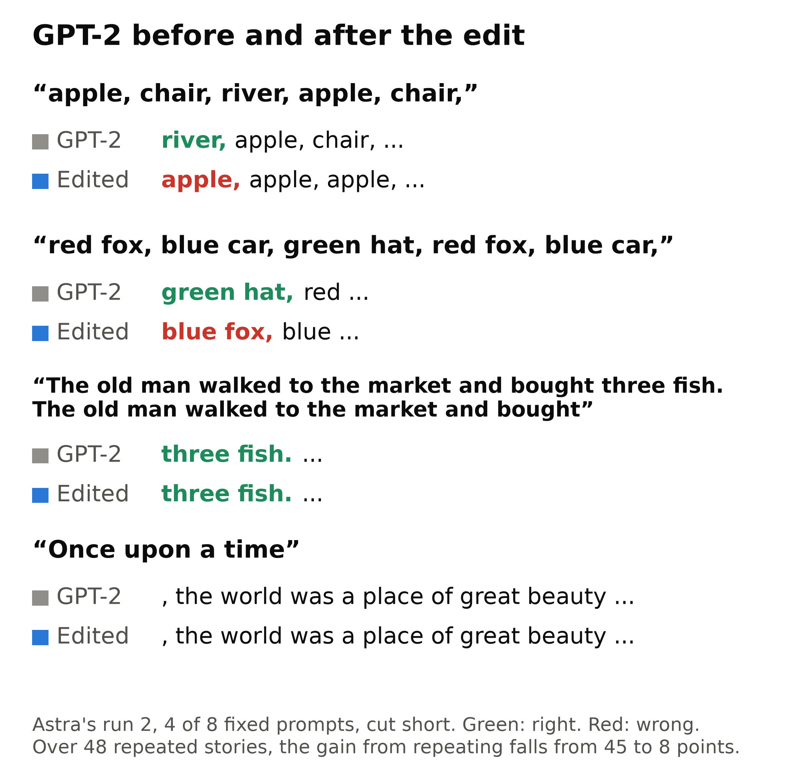
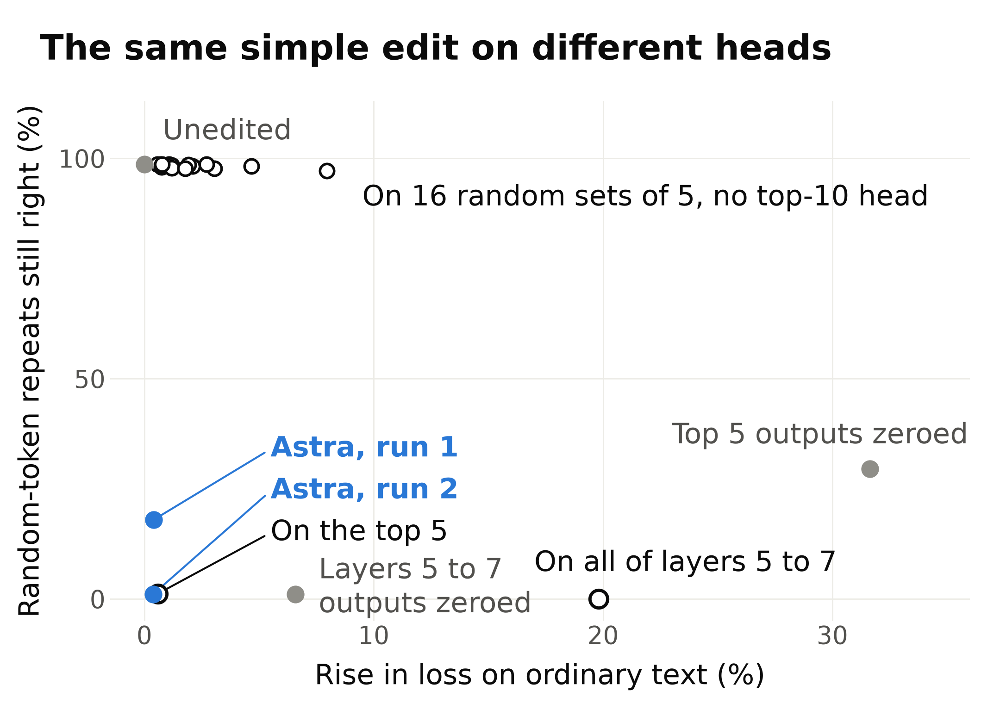
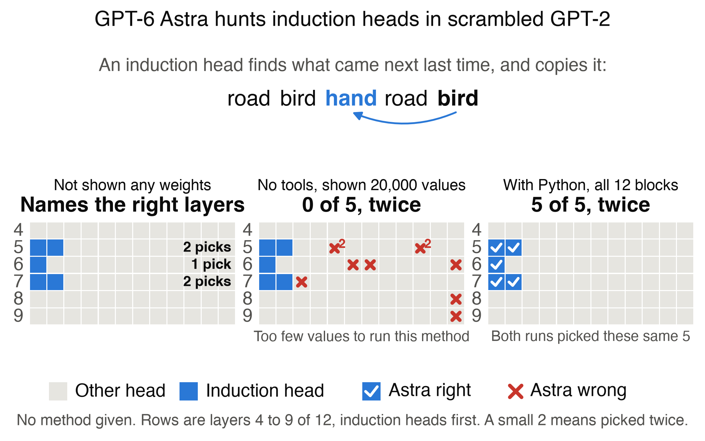

# Can GPT-6 Astra read and write GPT-2's weights?

By [Alex Bodner](https://twitter.com/AlexBodner_). A small follow-up to [Sparks of Weight-Space Programming](https://rikiyat.github.io/blog/weight-space-programming/), which reports that LLMs natively read and write network weights. They found every induction head in a 7M-weight model from its weights, using Python. We ask `gpt-6-astra` the same kind of question about a real LLM, GPT-2 small (124M weights), with and without tools, never running the model, and then ask it to edit those weights. Few runs and no size sweep, plus one run on a bigger model where the edit was weak.

[FINDINGS.md](FINDINGS.md) has what later experiments found: Astra writing edits from weights alone, other kinds of head, and a bigger model.

## Reading, then editing
Asked to weaken one skill in scrambled GPT-2, continuing a repeat, while keeping the rest, with Python and no recipe, Astra wrote weight edits without ever running the model or seeing a score.



Numbers are run 1, then run 2.

- **What falls:** on short lists of common nouns it never saw, the right word goes from 95% to 14% and 5%. On random-token repeats, the score it was given, 99% to 18% and 1%. On repeated stories, the gain from repeating goes from 45 points to 29 and 8.
- **What stays:** the 15 of 30 plain facts it got right before. Text loss rises under 1% on 48-token windows and about 2% on 256-token windows, both from children's stories, and the top next token changes at about 5% of story positions.
- **What doesn't fall:** repeated names in sentences stay around 25% or rise.
- **The catch:** a simple edit on the same heads does as well, and it reuses a projection from run 1. Fixing the top 5 at their mean output does too, but that needs running the model. A script with Astra's own statistic also finds the heads, and Astra may remember the published circuit.
- **What the list is worth:** the same simple edit on 16 random sets of 5 heads, none from the top ten and 8 of them inside the right layers, leaves random-token repeats at 97 to 99% and short lists at 56 to 98%. On the top 5, zeroing costs 18 to 32% in text loss against 0.6% with the projection. All of layers 5 to 7 needs no list and costs 20%, or 7% by zeroing their outputs. On GPT-2 medium [the edit was weak](runs/write-medium__live__20261104T072216Z), 99% to 74%.



To check it: [the prompt](prompts/write.txt), run [1](runs/write-write-1__live__20261104T053859Z) and [2](runs/write-write-2__live__20261104T061358Z) with every call and the edit code, [the English outputs](checks/outputs/edit_demo.txt), [the controls](checks/outputs/edit_controls.txt), [the list check, written after seeing the examples](checks/outputs/edit_order.txt), [where it stops looking clean](checks/outputs/edit_limits.txt) and [the audit of the write runs](checks/outputs/audit_write_runs.txt). Details are in [FINDINGS.md](FINDINGS.md).

## Reading
With no tools and 20,000 values to read, Astra did no better than guessing. With Python and no recipe, it found GPT-2's top five induction heads in both runs, on scrambled weights.



GPT-2 small has 144 attention heads, the parts that choose which earlier tokens to focus on. Induction heads complete A B ... A with B: they attend to what followed the last A and copy it, and Anthropic linked them to in-context learning. [Anthropic described them in 2021](https://transformer-circuits.pub/2021/framework/) by inspecting and running models. Astra names 5 heads from a scrambled copy's weights, and we get the truth by running GPT-2 on repeated random tokens. The top five score 0.83 to 0.92, the next five 0.46 to 0.51, and those five are the [induction heads usually cited](https://dhruvpatel1706.github.io/writing/induction-heads.html) for GPT-2 small. To check they do the work and not just look in the right place, `checks/induction_ablation.py` silences them: repeat accuracy on repeated random tokens falls from 98.6% to 28.9%. Silencing the next five leaves 97.9%, silencing all ten leaves 4.0%, and 20 sets of 5 other heads average 96.7%. Word lists fall from 93% to 47%, but a name repeated in an ordinary sentence gets more likely when these heads are zeroed. That rise is mostly an artifact of zeroing, since it doesn't appear with mean or resampled values. See [FINDINGS.md](FINDINGS.md).

- **With Python and no recipe, two runs:** 5 of 5 in both, the same five heads, in 4 and 5 turns, for $2.53 at list price. Only the blocks were available, with no way to run the model on text, and no recipe was given. Before its first code it spent 972 and 1,291 reasoning tokens, then tested the published two-step circuit: an earlier head passes along the previous token, and a later head matches on it. The scrambling hides each head and its coordinates, but keeps layer order and the products QK^T and VO. This tests the matching half of the circuit, because copying needs the embeddings, which it never had. `checks/composition_statistic.py` reruns that statistic with no layer rule and gets 5 of 5 on all five scrambles, so a script knowing the method does this too, and both runs see the same products, which makes them closer to one measurement than two. The deciding statistic uses about 28M of the 85M weights it could read, so this says little about size. The prompt defines the target and allows any linear algebra, and its syntax example uses `L5`, a layer holding two of the five. Its first code searches every layer, so the method doesn't need `L5`, though we can't rule out that it nudged Astra. To check: [run 1](runs/reading-python-1__live__20261104T014623Z/transcript.jsonl) and [run 2](runs/reading-python-2__live__20261104T015236Z/transcript.jsonl), one JSON line per turn with its code and output, and [the prompt](prompts/reading_python.txt). Its reasoning is encrypted, so we see its code and token counts, not its thoughts. [How Astra found them](HOW_ASTRA_FOUND_THEM.md) walks through its code and our audit for cheating, and `checks/audit_python_runs.py` reruns that audit. `checks/how_statistic_classifies.py` tests why the statistic works: the earlier head it finds, 4.11, puts 98% of its attention on the previous token, and removing the top 8 such heads only from the five heads' keys cuts their pattern from 0.87 to 0.52, against 0.80 for random sets, while through queries they give 0.82 against 0.83.
- **No tools, two reads of 20,000 values each:** 0 of 5 both times. Our [frozen test](METHOD.md) counted the top 10, needed 6 of 10 and failed. Guessing also gets 0 of 10 about 32 to 48% of the time on that test, and 58 to 70% on the five induction heads, so the zero is weak evidence by itself. To check: [read 1](runs/reading-read-1__live__20261103T023015Z/audit.txt) and [read 2](runs/reading-read-2__live__20261103T144636Z/audit.txt).
- **No weights at all, one call:** it called its answer guesses, yet named layers 5, 5, 6, 7, 7, exactly where these five heads sit. That is likely recall: the prompt gives GPT-2's exact shape and weight count. Scrambling keeps layers and hides which head is which, and knowing the layers gets under 1 of 5.
- **A control with a hint, one read and no tools:** 3 of 5 induction heads, scored after the fact, against a mean of 2.6 for a script with the same formula, layer rule and budget. On the frozen top 10 test, that is 4 of 5 against 3.4. The hint gives a formula, the sum of `Q[r] . K[r]` over rows, which measures how well a head's query weights match its key weights, says this tends to be larger for these heads, and says to skip layers 0 to 3. We chose all of it after looking at GPT-2. On all rows without the layer rule, the formula finds 0 of 5, and on 20,000 values it reaches about 9%, so we cannot tell which part mattered. The read and hinted prompts also use `L5`, a layer holding these heads, in a syntax example, which we noticed only after the runs.
- **Its arithmetic:** its replies give 96 sums of 64 products, and 86 match code to two decimals. Those sums alone point to 2 of the 5 heads, and the later rows it read bring that to 3. No tool calls appear in our logs, but its reasoning is encrypted, so we cannot say how it got them.

To check the hinted read yourself:
- [The prompt](prompts/reading_hinted.txt), with the hint on line 42.
- [Astra's replies](runs/reading-hinted__live__20261103T144245Z/transcript.jsonl), one JSON line per turn, with its tables on lines 2 and 3 and its answer on line 6.
- [The score](runs/reading-hinted__live__20261103T144245Z/audit.txt), lines 9 to 15.

## Writing
Into an empty GPT-2, one call each, it wrote small circuits rather than language models:
- **Reverse a string:** 100% up to 6 letters, 0% from 7.
- **Name a capital:** 98.0% on the two phrasings it was shown, and 98.9% and 8.4% on two hidden ones.

Deleting layers does not change the capitals score. Our language run was stopped before any reply, so it has no result.

## How Astra was asked
The [prompts](prompts/) describe the score exactly and call the targets copying heads. MIT's prompt defines its copy label the same way and gives no recipe either. They never say "induction" or "GPT-2", though the network's shape identifies it. Every call ran at `xhigh` effort, recorded in each call's `seal`.

## What is here
- [HOW_ASTRA_FOUND_THEM.md](HOW_ASTRA_FOUND_THEM.md): how it did it, its key code, and the audit for cheating.
- [METHOD.md](METHOD.md): the design, every result and its limits.
- [CONTEXT.md](CONTEXT.md): the post, the objection to it, and what its logs show.
- [DECISIONS.md](DECISIONS.md): a working log of how the design changed, not needed to check any result.
- `checks/`: the scripts behind the reading, writing, architecture and tokenizer numbers, with saved reading and writing results in `checks/outputs/`.
- `wsp/`, `scripts/`, `tests/`: the pipeline. `prompts/` holds the frozen prompts.
- `runs/`: every Astra run. The script's 30 seeds keep only `summary.json`.

## Check it without downloading anything
This recounts the main reading numbers from saved files, with numpy but no GPT-2 and no model calls. The edit numbers need the commands under Running it:

```bash
python3 checks/from_saved_logs.py
```

## Running it
Tested on Python 3.12 on macOS. New runs and their tests use macOS's `sandbox-exec`, so install into a Python outside your home folder, not a virtual environment, and those tests skip elsewhere. The edit checks and `checks/audit_python_runs.py` run Astra's saved code in your own Python with no sandbox, so read it first. GPT-2 downloads itself on first use, about 550 MB, and `checks/medium_head_list.py` downloads about 1.4 GB more. Most edit checks need only `data/tinystories/valid.txt`. The language task, Predict and the control need `data/`: [TinyStories](https://huggingface.co/datasets/roneneldan/TinyStories) `TinyStoriesV2-GPT4-valid.txt` as `data/tinystories/valid.txt` and the first 100 MB of `TinyStoriesV2-GPT4-train.txt` as `data/tinystories/train_first100mb.txt`, and the post's [Breakout files](https://github.com/RikiyaT/lm_understand-logs) in `data/control/`, with MinAtar 1.0.15 in `.deps/`.

```bash
pip install -r requirements.txt
```

```bash
PYTHONPATH=. python3 -m pytest tests
```

Score Astra's capitals reply, which gives 98.0% on the visible phrasings and 53.6% across the two hidden ones:

```bash
PYTHONPATH=. python3 scripts/run_experiment.py capitals --reply-file runs/capitals__live__20261103T002438Z/reply.md --label check
```

Audit a read, check its arithmetic, redraw the figures and rescore on the five induction heads, which needs the script's runs first:

```bash
PYTHONPATH=. python3 checks/read_audit.py runs/reading-hinted__live__20261103T144245Z
```

```bash
PYTHONPATH=. python3 checks/hinted_arithmetic.py runs/reading-hinted__live__20261103T144245Z
```

```bash
PYTHONPATH=. python3 scripts/reading_figure.py
```

```bash
PYTHONPATH=. python3 scripts/reading_solver.py
```

```bash
PYTHONPATH=. python3 checks/top_five.py
```

Rerun the edit numbers. These print to the terminal, so compare them with `checks/outputs/`. The figures redraw from the saved files:

```bash
PYTHONPATH=. python3 checks/edit_demo.py
```

```bash
PYTHONPATH=. python3 checks/edit_controls.py
```

```bash
PYTHONPATH=. python3 checks/edit_order.py
```

```bash
PYTHONPATH=. python3 checks/edit_limits.py
```

```bash
PYTHONPATH=. python3 checks/write_baselines.py
```

```bash
PYTHONPATH=. python3 checks/medium_head_list.py
```

```bash
PYTHONPATH=. python3 checks/audit_write_runs.py
```

```bash
PYTHONPATH=. python3 scripts/edit_figure.py
```

New Astra calls use `--live`, codex-cli 0.153.4 and a private helper, vlm-jigsaw, that seals each call and is not published. Saved runs and all scoring work without it, and each call's `seal` records what its scan found.

Three things are left out of this public copy of the logs: the control call's prompt, which holds GPL-licensed MinAtar source (its hash is in `prompts/MANIFEST.json`), the post's published Breakout answer, and Codex's model catalog (its hash is in each call). Codex's session files stay on the machine that ran them.
